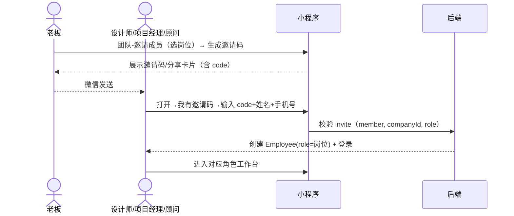
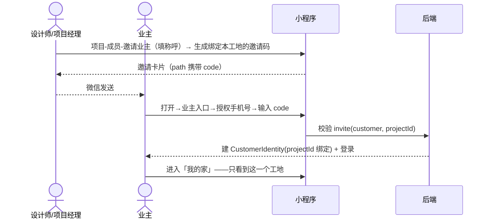
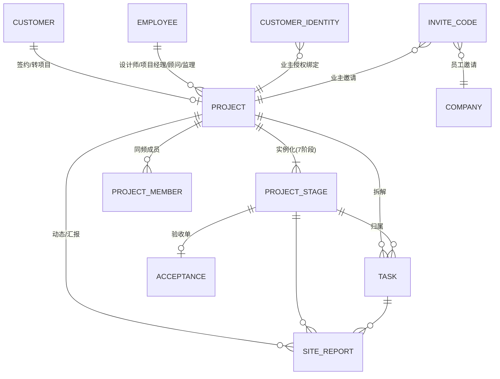
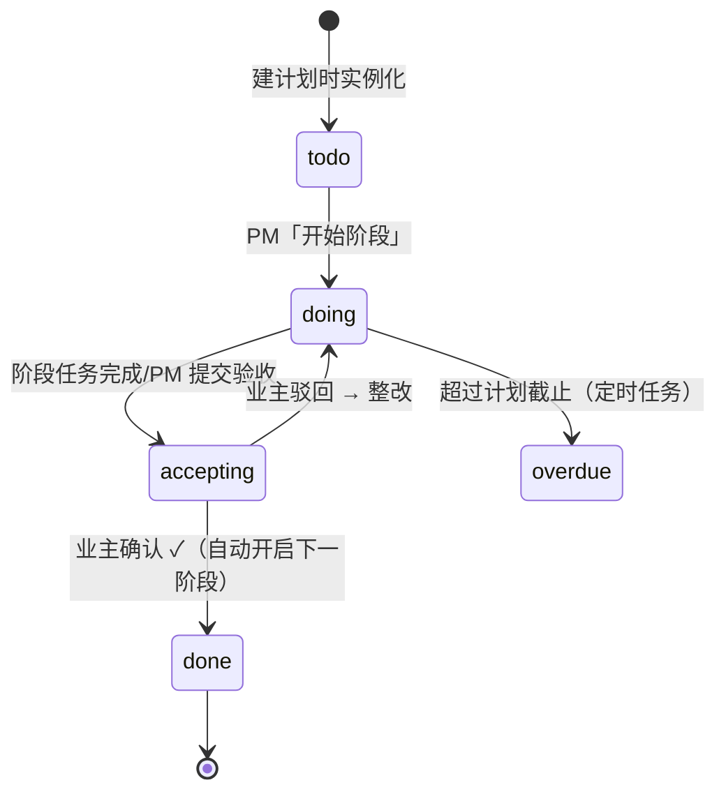
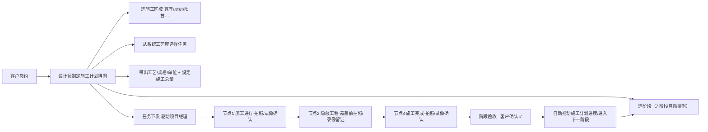

# 装得清（装得清小程序端）· 业务设计说明书

> 版本 v1.0 · 2026-09-08 ｜ 项目：th4-decoboon-app（uni-app Vue3+TS+Vite 微信小程序）
> 上游对齐：th4-decoboon 后端 rules.md / 用户体系与续费体系设计.md / 业务思考推导.md

---

## 1. 业务定位

中小家装企业的业务天然从「一个工地」展开：客户签约后进入工地履约，工地现场的状态牵动老板的资金、
设计师的方案还原、项目经理的施工组织、业主的安心。但传统协作里各方信息割裂——业主跑现场、设计师被催图、
老板靠电话问进度、项目经理口头汇报无凭证。

**装得清小程序 = 项目工地管理枢纽**，把工地做成一个可被授权的「同频空间」：

- 对**企业**：工地即经营单元（合同/收款/进度/风险一屏掌握），也是新的**业务起点**——承接线索客户后在此履约；
- 对**设计师**：方案交底、巡检、问题整改沉淀在工地时间线；
- 对**项目经理**：阶段任务化、现场汇报一键同步、验收流程线上化；
- 对**业主**：被邀请后只看到自己工地，进度照片实时可见、验收一键确认。

它承接装得清「获客 → 转化 → 履约 → 回款 → 经营」大闭环中的**转化与履约段**，
是家装公司日常业务动作最密集、最需要「同频」的枢纽环节。

---

## 2. 角色与组织模型

### 2.1 组织

```text
Company 企业（租户）            e.g. 安徽昭青·装得清装饰
 └─ Store 门店                  e.g. 包河旗舰店
     └─ Employee 成员           老板 / 设计师 / 项目经理 / 家装顾问 / 监理
Customer 客户（CRM 转化域）  ──签约──▶  Project 项目工地（履约域）
                                          ├─ ProjectStage 施工阶段 × N（标准 7 阶段）
                                          ├─ Task 施工任务
                                          ├─ SiteReport 工地动态/汇报（同频时间线）
                                          └─ Acceptance 验收单（客户确认闭环）
CustomerIdentity 业主账号（小程序侧，受项目级授权） ──绑定──▶ Project
```

### 2.2 角色矩阵（MVP）

| 角色 | 平台标识 | 业务对象 | 核心职责 | 登录 |
| --- | --- | --- | --- | --- |
| 企业负责人 | `boss` | Employee(role=boss) | 注册企业、邀请员工、全局看板、资金/风险 | ✅ |
| 设计师 | `designer` | Employee | 客户转化、方案、计划编排、巡检 | ✅ |
| 项目经理 | `pm` | Employee | 阶段开工、任务推进、现场汇报、提交验收 | ✅ |
| 家装顾问 | `marketer` | Employee | 客户登记/跟进/转项目 | ✅ |
| 业主 | `customer` | CustomerIdentity | 同频查看进度/动态，确认验收（只读+验收） | ✅（微信授权） |

> 工程监理可先以 `pm` 的一个岗位（title=监理）承载；后续如需独立看板再扩展 `Role`。

---

## 3. 用户注册 / 登录 / 邀请机制（第一个要立住的用户闭环）

### 3.1 登录方式（微信小程序）

1. **微信一键登录**：`uni.login` → `code2session`；「获取手机号」按钮 `open-type=getPhoneNumber` 解密手机号。
2. **手机号 + 验证码**：兜底通道（H5/企业微信内），SMS 验证码 5 分钟有效。
3. 登录后按「手机号是否已注册」分流：已注册 → 直接进角色工作台；未注册 → 身份选择（见 3.2）。

### 3.2 首次使用·身份选择（register）

| 卡片 | 去向 | 系统动作 |
| --- | --- | --- |
| 我是企业负责人 | 创建企业 | 建 `Company + Store + Employee(BOSS)`，赠送试用期，进入老板工作台 |
| 我有邀请码（员工） | 输入邀请码 | 校验 → 按邀请码岗位加入企业 → 进入对应角色工作台 |
| 我是业主 | 输入业主邀请码 | 校验 → 绑定所属 `Project` → 进入「我的家」业主视图 |

### 3.3 邀请机制（两条邀请链）

**A. 员工邀请（老板 → 设计师/项目经理/顾问）**



**B. 业主邀请（设计师/项目经理/顾问 → 业主）**



规则：
- 手机号为平台全局唯一登录名；企业侧手机号绑定 `Employee`，业主侧绑定 `CustomerIdentity`。
- 邀请码一次性有效（状态 `valid → used/expired`），员工邀请默认有效期至年底，可后台续期。
- 安全边界：业主账号**永远拿不到企业员工数据**，只能访问 `projectId` 归属的工地内容（进度/动态/验收），这是「同频」而非「透明」。

---

## 4. 领域模型（履约域：客户 → 项目 → 计划/阶段/任务 → 动态/验收）

> 与 th4 后端实体约定对齐：实体对象关联（`Project.designer: Employee`）、无 DTO、
> 序列化用 `@ServiceProperties` 过滤（客户视角隐藏金额/内部备注等）。

### 4.1 实体关系总览



### 4.2 实体要点

| 实体 | 关键字段（对象关联） | 说明 |
| --- | --- | --- |
| Customer 客户 | `owner: Employee`、`stage`、`source`、社区/面积/预算、`project` | 转化域实体；签约后指向 `Project` |
| CustomerFollow 跟进 | `customer`、`emp`、`way`、`content`、`nextFollowAt` | 跟进记录时间线 |
| Project 项目/工地 | `customer/designer/manager/marketer/supervisor`、`status`、`progress`、金额、工期、`cover` | **枢纽实体**；`progress` 由阶段权重自动汇总 |
| StageTemplate 阶段模板 | name/sort/weight | 默认 7 阶段：拆除改造(5)→水电(15)→泥瓦(20)→木工(15)→油漆(20)→安装(15)→竣工(10) |
| ProjectStage 阶段实例 | `project`、name、sort、weight、`status`、`owner`、计划/实际时间、progress | 可开可收，验收驱动状态 |
| Task 施工任务 | `project/stage/owner/creator`、`status`、`priority`、验收标准、计划/实际时间 | 阶段内拆解到可执行动作 |
| SiteReport 动态/汇报 | `project/stage/task`、`type`、内容、图片、`author`、`visibleToCustomer` | 同频时间线的“一条声音”；图片沉淀为工地相册/履约证据 |
| Acceptance 验收单 | `project/stage`、`submitBy`、`result`、`issues`、`customerStatus`、`customer` | **客户确认**形成阶段闭环 |
| ProjectMember 同频成员 | `project/emp|customer`、roleInProject、label | 谁在看、谁能发 |
| InviteCode 邀请码 | `type(member/customer)`、`companyId/projectId`、`role` | 两条邀请链的凭据 |

### 4.3 关键状态机

**项目 Project**：`preparing 待开工 → ongoing 施工中 ⇄ suspended 停工 → accepting 竣工验收 → finished 已完工 → settled 已结算`
（`progress` 由阶段完成度加权自动计算并回写，保证「一眼看到真相」。）

**阶段 ProjectStage**：



**任务 Task**：`todo → doing → accepting（完成并申请验收）→ done（内部验收通过）`
**客户 Customer**：`intention 意向 → measure 量房 → quote 报价 → sign 签约 → construction 施工 → done 完工`
（流失 `lost` 任意阶段可入）

---

## 5. 同频权限矩阵（强视图第一原则：先限权再渲染）

| 能力 | boss | designer | pm | marketer | customer |
| --- | :-: | :-: | :-: | :-: | :-: |
| 查看企业全局 / 全部项目 | ✅ | – | – | – | – |
| 查看参与的项目 | ✅ | ✅ | ✅ | ✅ | ✅(仅绑定项目) |
| 查看客户 CRM | ✅ | ✅ | ✅ | ✅ | – |
| 新建/编辑项目 | ✅ | ✅ | – | – | – |
| 编排施工计划/阶段 | ✅ | ✅ | – | – | – |
| 新建/指派任务 | ✅ | – | ✅ | – | – |
| 现场汇报 / 阶段开工 | ✅ | ✅ | ✅ | ✅ | – |
| 提交验收 | ✅ | ✅ | ✅ | – | – |
| **业主确认验收** | – | – | – | – | ✅ |
| 客户跟进 / 转项目 | ✅ | ✅ | ✅ | ✅ | – |
| 邀请员工 / 邀请业主 | ✅ / ✅ | – / ✅ | – / ✅ | – / ✅ | – |
| 查看合同/收款 | ✅ | – | – | – | – |
| 查看工地相册 | ✅ | ✅ | ✅ | ✅ | ✅(本工地) |

> 落地：`src/roles/permission.ts` + `src/domains/project/scope.ts`；后端以 `@ServiceProperties` + `@AutoInject(empId/companyId)` 做服务端强制。

---

## 6. 与装得清全链路的关系（为什么它是“业务起点”）

装得清完整板块：短视频获客 → 线索 → **客户 → 项目工地（小程序枢纽）** → 材料 → 财务回款 → 经营统计。

- 小程序把「获客线索沉淀下来的客户」接住：登记客户 → 跟进 → **转施工项目**；
- 工地履约（进度/汇报/验收/相册）是小程序前期最重的日常业务，先做深；
- 老板工作台的「资金进度/风险」与后续材料、财务板块同源，字段已预留（合同金额/已收款/阶段权重），
  后端可无缝生长出材料与财务域。

---

## 7. 数据流与后端 Provider 路由映射

小程序按业务域通过 `src/domains/<domain>/api.ts` 直连 th4 Provider。Provider 路由与接口缺口统一维护在 `docs/04-App工程架构与接口对接.md`。

响应结构：`{success, data(实体|Page<实体>), errorCode}`（th4-web 同协议，`data` 直接是领域实体）。

---

## 8. MVP 范围与演进

- **本期已含**：注册/登录/邀请双链、客户 CRM、项目/计划/阶段/任务、现场汇报动态、工地相册、阶段验收（客户确认）、
  角色工作台与消息、同频权限。
- **下一期**：材料进场批次/库存、财务收款计划与支出、监理独立角色、订阅消息（微信模板消息）、
  后端 `project/**` 域落地并切换联调、企业套餐续费。

---

## 9. V1.1 迭代 · 以设计师视角贯通「签约 → 排期 → 任务 → 节点推进 → 验收」业务闭环

> 设计视角核心命题：**设计师决定“做什么、怎么做、做多少、在哪做”，项目经理负责“一步步做并留下证据”，验收完成自动推动计划进度。**

### 9.1 新增概念

| 概念 | 说明 | 落地 |
| --- | --- | --- |
| 施工区域 Zone | 卧室、客厅、厨房、卫生间、阳台、全屋等字典 | 全局字典，任务按“区域”落位 |
| 内置工艺任务库 CraftTask | **系统内置**的施工任务：`施工工艺 + 规格要求 + 计量单位(+是否隐蔽)`，天然归属某个施工阶段并可落到多个区域 | `CraftTask`，设计师只做“选择+落区+定量” |
| 任务实例 Task | 设计师排期时从工艺库选择生成；携带 `zone/craft/spec/unit/quantity` | `Task` 扩展 |
| 任务节点 TaskNode | `施工进行(start) → 隐蔽工程(conceal，按工艺决定) → 施工完成(finish)`，每节点需 PM **拍照/录像确认** | `TaskNode` + `TaskMedia(image/video)` |
| 施工日报 DailyReport | 以“天”聚合：任务节点确认 + 当日文字/影像汇报 | `dailyReportsOfProject` |

### 9.2 设计师视角闭环（签约后）



### 9.3 内置工艺库示例（设计师选择面）

| 阶段 | 示例工艺任务（code） | 区域 | 规格要点 | 单位 |
| --- | --- | --- | --- | --- |
| 拆除改造 | CC-01 成品保护 / CC-02 旧饰面铲除 | 全屋/客厅… | 保护膜≥1.2mm 无漏铺 / 铲除至坚实基层 | 项/㎡ |
| 水电工程 | SD-01 强电布线 / SD-03 给水管路敷设 | 全屋/厨卫/阳台 | 强弱电间距≥300mm / 打压 0.8MPa | ㎡/m（隐蔽） |
| 泥瓦工程 | NW-04 防水涂刷 / NW-05 闭水试验 | 厨卫/阳台 | 上返 300mm 淋浴 1800mm / 48h 无渗漏 | ㎡/项 |
| 木工工程 | MG-01 轻钢龙骨吊顶 / MG-04 背景墙木作 | 客厅/走廊 | 主龙骨 900 副龙骨 400 / 基层牢固 | ㎡（隐蔽） |
| 油漆工程 | YQ-01 基层处理 / YQ-02 乳胶漆 | 全屋 | 2m 靠尺≤2mm / 无流坠无刷痕 | ㎡ |
| 安装工程 | AZ-02 橱柜 / AZ-04 木门 | 厨房/卧室 | 柜门缝隙均匀 / 门缝 3-4mm | 套/樘 |
| 竣工验收 | JG-01 开荒保洁 / JG-02 竣工验收检测 | 全屋 | GB 50210 / 甲醛≤0.08 | ㎡/项 |

### 9.4 为什么“任务节点+影像确认”是业务刚性

- **隐蔽工程不可逆**：水电管线、防水、龙骨覆盖前必须留证，否则后期返工无法定责——`conceal` 节点强制在覆盖前确认；
- **日报即证据链**：每个任务的开展/进行/完成 = 一次带照片/视频的节点确认，自动按天形成施工日报，业主与老板无需到现场即可核验；
- **进度真实可信**：项目/阶段进度由“任务节点完成度”汇总，验收确认后才推进下一阶段，杜绝口头报进度。
