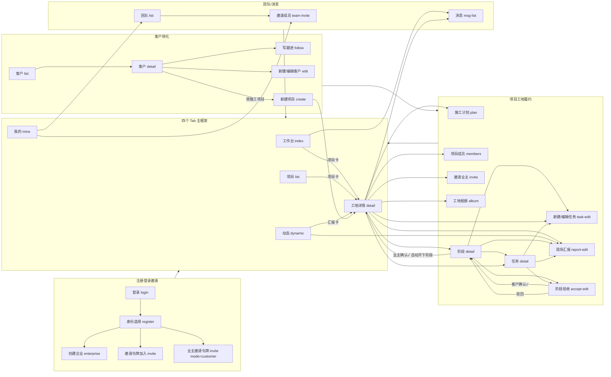

# 装得清小程序 · 闭环页面逻辑与强视图说明

> 本文件回答两件事：**页面怎么连成闭环**（用户每次操作都能走向下一步并得到反馈），
> 以及**每个页面用哪些“强视图”让进展一眼可掌握**（进度环/时间线/甘特/看板/相册，而不是纯表单罗列）。

---

## 1. 页面地图（28 页）



---

## 2. 五条核心闭环链路（业务叙事）

### 链路 A：老板建企业 → 邀请设计师/项目经理 → 员工接受邀请
1. `登录` → 选择「我是企业负责人」→ `创建企业`（企业/门店/城市/称呼）→ 系统建 Company+BOSS、送 30 天试用 → 进入**老板工作台**。
2. 老板在 `我的-邀请员工`（或工作台快捷入口）选岗位生成邀请令牌 → 微信发给设计师/项目经理。
3. 对方打开小程序 → `登录` → 「我有邀请令牌」→ 输入 `token + 姓名 + 手机号 + 密码` → 进入**设计师/项目经理工作台**。
4. 反馈闭环：`我的-团队成员` 实时出现新成员；邀请令牌状态变「已使用」。

### 链路 B：客户从哪里来 → 登记/跟进 → 转施工项目
1. 顾问从 `客户 list`（或工作台快捷入口）登记客户（来源/阶段/意向小区/预算）→ `客户 detail`。
2. 每次沟通在 `客户 detail-写跟进` 沉淀（方式/内容/下次跟进）→ 列表展示最近跟进时间。
3. 客户走到「签约」→ `客户 detail-转施工项目` → `新建项目`：选客户、填地址/金额/工期、指派设计师与项目经理 → 系统自动生成 7 阶段施工计划 + 同频成员。
4. 反馈闭环：客户回到 `客户 list` 显示「已转项目」；新项目出现在**老板/设计师/项目经理的项目列表**。

### 链路 C：项目经理怎么把工地干起来（阶段 → 任务 → 汇报）
1. `工地详情-进度` 看到 7 阶段时间线，点「开始『拆除改造』」→ 阶段变进行中、发布开工动态（业主可见）。
2. 阶段内 `任务` 拆解到具体动作；点任务「开始/完成并申请验收」，任务动态自动进时间线。
3. 日常在 `工地详情` 或 `动态` Tab 点「现场汇报」：类型（进度/打卡/材料/问题）+ 照片 + 是否同步业主 → 汇报即动态。
4. 反馈闭环：业主端 `我的家` 与 `动态` Tab **实时**出现照片与进展；工地相册沉淀影像。

### 链路 D：阶段验收的「同频拍板」（本产品最关键闭环）
1. 阶段任务完成后，PM 在 `阶段 detail` 点「提交验收」→ 填结论/整改项/照片 → 阶段变 `待验收`，业主收到「验收待您确认」。
2. 业主打开 `我的家-需要关注` 或消息 → 查看验收单 + 现场照片 → 点「确认验收 ✓」或「有异议，驳回」。
3. **确认**：系统发「业主已确认」动态 → 阶段 `done` → **自动开启下一阶段** → 老板/PM 工作台同步刷新。
4. **驳回**：阶段回 `进行中`(整改) → PM 收到整改任务，整改后重新提交——形成「提交→确认→开门→下一关」的**强闭环**。

### 链路 E：老板/企业怎么“不打电话也知道”
- 老板工作台：在建/待开工/待验收/停工四指标 + 需要关注（待确认验收、停工项目）+ 最新动态。
- `工地详情`：整体进度（阶段权重自动算）+ 当前阶段 + 资金进度（合同/已收/收款率）。
- 风险视图：停工项目在 `项目 list` 标红可筛，消息中心推送逾期/停工预警。

---

## 3. 强视图设计原则（为什么业主“一看就懂”）

1. **一个工地一张主图**：`工地详情` 顶部 = 工地封面 + 整体进度条 + 当前阶段 + 关键日期 + 同频成员头像墙；
   不再用表格让业主猜“干到哪了”。
2. **阶段 = 竖向里程碑时间线**：绿点=已验收、橙点=进行中、灰点=未开始、红点=逾期，点任意阶段下钻任务。
3. **计划 = 横向进度条甘特**：每阶段一根条（计划/实际着色），一眼看到计划偏差。
4. **动态 = 卡片时间线**：谁、什么时候、在哪个阶段/任务、干了什么、附现场照片；业主可见标记明确。
5. **验收 = 一次“拍板页”**：结论 + 整改项 + 照片 + 两个大按钮（确认/驳回），把抽象流程变成一次点击。
6. **角色即视图**：客户只看到“我的家 + 动态 + 成员 + 相册”；员工按权限矩阵裁剪按钮（没权限不显示，后端兜底）。

---

## 4. 逐页视图说明（页面 → 区块 → 关键操作/跳转）

> 字段与交互以 `src/pages/**` 实际代码为准，下表是“视图-操作-闭环”速查。

### Tab 页
| 页面 | 区块 | 关键操作 / 跳转 | 空态 |
| --- | --- | --- | --- |
| 工作台 `index` | 品牌头部、角色横幅、四指标卡、快捷入口、需要关注、我的项目、最新动态 | 项目卡→工地详情；验收横幅→工地详情；快捷→客户/新建/团队/消息 | 无项目引导新建/联系企业 |
| 项目 `project/list` | 搜索/状态筛选、项目卡（封面/进度/人员/金额） | 卡→工地详情；「＋新建」→新建项目（按权限） | 空态引导新建 |
| 动态 `dynamic` | 作用域说明、汇报时间线 | 「＋汇报」选工地→写汇报；汇报卡→大图预览 | 引导项目经理打卡 |
| 我的 `mine` | 身份卡、我的企业/团队/参与项目、退出 | →团队/邀请成员/消息 | — |

### 注册登录邀请
| 页面 | 关键逻辑 |
| --- | --- |
| 登录 | 微信授权入口 / 手机号密码登录；未注册进入身份选择；含隐私协议勾选 |
| 注册-身份选择 | 企业负责人→创建企业；有邀请令牌→加入；业主→业主邀请令牌 |
| 创建企业 | 短信验证、登录密码、企业/门店/地址/负责人；建 Company+BOSS+试用后自动登录 |
| 邀请加入 | 员工使用绑定手机号和一次性令牌设置密码入团队；业主令牌绑定授权工地 |

### 客户
| 页面 | 强视图 | 操作/跳转 |
| --- | --- | --- |
| 客户 list | 阶段漏斗标签 + 来源/预算/最近跟进 | 搜索筛选；卡→详情；FAB 登记 |
| 客户 detail | 客户卡 + 跟进时间线 + 关联项目卡 | 电话/复制；写跟进；转施工项目 |
| 写跟进 | 方式单选 + 内容 + 下次跟进 | 保存→时间线+1 |
| 客户编辑 | 分组表单 | 保存/编辑回填 |

### 项目工地
| 页面 | 强视图 | 操作/跳转 |
| --- | --- | --- |
| 工地详情 | 封面+总进度+当前阶段+头像墙；**待验收横幅**；五 Tab（进度/计划/任务/动态/成员） | 阶段线→阶段详情；开始下阶段；写汇报；加任务；邀请业主；相册；资金进度 |
| 新建项目 | 四步分组表单 | 选客户→自动生成 7 阶段计划与成员 |
| 施工计划 | 工期汇总卡 + 阶段甘特 | 阶段→阶段详情 |
| 项目成员 | 团队/业主分区 | 邀请业主（同频）；跳团队邀请员工 |
| 邀请业主 | 邀请令牌 + 4 步同频闭环说明 | 生成/复制/微信分享 |
| 工地相册 | 汇报/验收照片墙 | 预览大图；上传入口在汇报与验收流程 |

### 阶段 / 任务
| 页面 | 强视图 | 操作 |
| --- | --- | --- |
| 阶段详情 | 阶段卡（计划/实际/负责人/权重）+ 验收横幅 + 任务列表 + 阶段动态 | 开始阶段；汇报；提交/查看验收；加任务 |
| 任务详情 | 任务卡 + 信息 + 状态动作 | 开始 / 完成并申请验收 / 内部验收通过 / 汇报 / 编辑 |
| 新建/编辑任务 | 分组表单（阶段/负责人/优先级/日期/验收标准） | 保存 → 阶段任务列表+1 |
| 进度汇报 | 汇报上下文卡 + 类型 + 标题 + 内容 + 照片 + 是否同步业主 | 发布 → 动态时间线 & 业主可见 |
| 阶段验收 | 员工：结论/整改项/照片提交；**业主：确认/驳回拍板页** | 客户确认→自动开启下阶段 |

### 团队 / 消息
| 页面 | 操作 |
| --- | --- |
| 团队成员 | 按岗位筛选；公司/试用信息 |
| 邀请成员 | 选岗位生成邀请令牌、复制/分享、历史码状态 |
| 消息通知 | 任务提醒/逾期/动态/验收/系统；未读红点；点击进对应工地 |

---

## 5. 验收清单（怎么算“闭环通了”）

1. 分别使用 **老板、项目经理、业主** 三个测试账号走一遍：
   - PM 打开江南新苑工地 → 泥瓦阶段点「查看验收单」= 待业主确认；
2. 切到**业主王先生** → 工作台出现「验收等待您确认」→ 工地详情横幅 → 验收页 → **确认验收 ✓**；
3. 切回**老板/PM** → 泥瓦阶段变「已验收」，**木工阶段自动变进行中**，动态时间线多一条「业主已确认」；
4. 顾问建新客户 → 转项目 → 老板/设计师/项目经理三端列表都出现新工地；
5. 老板邀请一个设计师（生成邀请令牌）→ 退出 → 「员工邀请」页输入 → 成功进入设计师工作台。

---

## 6. V1.1 迭代 · 设计师视角闭环页面逻辑

### 6.1 新增/强化页面（28 页 = 原 26 + 排期 1 + 日报 1）

| 页面 | 强视图 | 操作/闭环 |
| --- | --- | --- |
| `项目/plan`（强化） | 阶段甘特 + 每阶段任务卡（区域/总量/状态） | 设计师/BOSS 点「去排期」；任务卡→任务详情；阶段→阶段详情 |
| `项目/plan-edit` 施工计划排期（新） | 阶段芯片 → 区域芯片 → 工艺库卡片（工艺/规格/单位）→ 已选购物篮（数量步进） | 设计师**从系统内置工艺库选择任务**，落“阶段×区域”，设总量 → 保存下发 |
| `任务/task-detail`（重构） | 工艺/规格/区域/总量信息卡 + **三节点时间线**（施工进行/隐蔽工程/施工完成） | PM 对每个节点「📷 拍照/录像确认」；隐蔽节点覆盖前强制确认；完成后进阶段验收 |
| `report/daily` 施工日报（新） | 按天聚合：任务节点事件（谁/几点/照片/视频）+ 当日现场汇报 | 日报核心=任务开展/进行/完成节点描述；可一键补写日报 |

### 6.2 迭代后的链路 D′：设计师排期 → PM 节点推进 → 验收推动计划

1. 签约完成 → 设计师进入 `施工计划` →「去排期」：
   选阶段（自动带出 7 阶段与工期）→ 选施工区域（客厅/厨房/卫生间…）→ 从**内置工艺库**搜索并选择任务
   （自动带出施工工艺、规格要求、计量单位）→ 设定施工总量 → 保存下发项目经理。
2. PM 收到任务（工作台-待办、工地-任务、消息提醒）：
   - **节点①施工进行**：拍照/录像 → 确认开工；
   - **节点②隐蔽工程**（水电/防水/龙骨等工艺自动带隐蔽节点）：覆盖前拍照/录像 → 隐蔽验收；
   - **节点③施工完成**：拍照/录像 → 完成并申请阶段验收。
3. 每步节点确认自动写入**施工日报**与同频动态，业主/老板/设计师实时可见。
4. 阶段任务全部完成后 → PM 提交阶段验收 → **业主确认 ✓** → 阶段闭环、任务自动完结、
   **自动推动施工计划进度并开启下一阶段**。

### 6.3 验收清单补充
1. 以「设计师」身份进入项目 → 施工计划 → 去排期：按阶段+区域从工艺库添加 ≥2 项任务（如给水管路敷设=卫生间/隐蔽）并设总量 → 保存；
2. 切「项目经理」：任务详情依次确认三节点（拍照/相册选图即可），隐蔽未确认前不可点“完成”；
3. 打开「施工日报」：看到今天按天聚合的 开始/隐蔽/完成 节点与照片/视频证据；
4. 全部任务完成 → 阶段验收 → 切「业主」确认 → 回看计划进度被推动、任务全部变“已完成”。

## 7. V1.2 · 业务员经营视图闭环

业务员登录后固定使用 `工作台 / 客户 / 项目 / 我的` 四个 Tab，围绕“客户经营和项目可见性”形成闭环：

```text
工作台黄金营销指标
  → 登记客户
  → 电话/微信触达
  → 标记已加微信
  → 持续跟进取得信任
  → 获得房屋地址
  → 客户转“待量房”
  → 营销工作结束并交后续专业角色
  → 通知、业绩和项目只读复盘
```

业务员不参与报价、合同、施工汇报和验收拍板；其客户漏斗只保留 `待首联 → 跟进中 → 待量房 → 流失`。黄金营销时段按客户录入系统的时间计算：`0-3天` 为黄金期、`4-7天` 为升温期、`8-15天` 为保温期、`15天以上` 为沉睡风险。

| 页面 | 强视图 | 操作闭环 |
| --- | --- | --- |
| `pages/index/index` | 客户数、黄金期客户、已加微信、待量房、转化率、平均转化周期 | 点指标进入客户/业绩页面 |
| `pages/customer/list` | 黄金营销分层、微信状态、待量房、客户状态摘要 | 搜索、登记、筛选、进入详情 |
| `pages/customer/detail` | 客户资料、微信状态、房屋地址、营销阶段、跟进时间线 | 编辑客户、写跟进、发起量房、选择设计师并提交 |
| `pages/customer/edit` | 基础资料、来源、客户阶段、微信状态/微信号、房屋地址、预算、备注 | 获得地址并转待量房；不出现报价字段 |
| `pages/project/list` | 只显示业务员参与/负责的客户项目 | 筛选状态、查看工地详情 |
| `pages/project/detail` | 项目进度、阶段、任务、当前工地状态 | 业务员只读查看，不可修改施工状态 |
| `pages/performance/index` | 微信添加量、待量房量、转化率、平均转化周期、黄金期分层 | 下拉刷新；从首页与“我的”进入 |
| `pages/msg/list` | 客户跟进、项目进度、任务逾期提醒 | 未读标记、点击跳项目详情 |

后端通过 `statistic/marketer/report` 聚合业务员经营指标，通过 `collab/notice/*` 生成并维护本人通知；客户状态在录入地址并转“待量房”时结束营销阶段。项目、阶段、任务查询均以当前登录员工和服务端参与关系为准。
