# 装得清小程序 · 设计师视角业务闭环与强视图交互

> 适用端：`th4-decoboon-app` 微信小程序 / H5  
> 服务端：`th4-decoboon` Provider API  
> 角色：`designer`，数据范围默认 `Company + Self` 的项目参与关系

## 1. 设计师职责边界

设计师不是“客户端里的一个列表角色”，而是设计经营与施工交付之间的责任枢纽：

1. 承接本人负责的客户，持续沉淀跟进记录与下次跟进时间。
2. 基于客户户型、面积与企业标准套餐生成方案报价，所有金额由服务端计算。
3. 推动报价提交、客户确认、报价转项目，保证设计与合同金额一致。
4. 从已接受报价生成项目，维护项目负责人、工期与施工阶段。
5. 按“阶段 × 区域 × 工艺 × 数量”编排施工任务并下发项目经理。
6. 查看施工节点留证、现场动态、整改问题和验收结果，持续校对设计落地。
7. 通过设计业绩页查看客户转化、报价接受率、签约额、项目数、任务风险与现场动态沉淀。

设计师不具备以下能力，服务端同样拦截：

- 查看同企业其他设计师的私人客户、报价和项目。
- 项目经理的开工、节点确认、现场推进动作。
- 企业资金收款、结算和全局经营数据。
- 修改服务端计算的报价金额、成本和项目进度。

## 2. 设计师强视图页面地图

| 维度 | 页面 | 设计师看到的核心事实 | 主要动作 |
| --- | --- | --- | --- |
| 工作台 | `pages/index/index` | 负责客户、待推进报价、在施项目、逾期任务、设计签约额 | 进入报价/客户/项目/消息 |
| 客户 | `pages/customer/list` | 只返回本人负责客户；按阶段、来源、小区筛选 | 登记客户、查看详情 |
| 客户详情 | `pages/customer/detail` | 基本信息、跟进时间线、关联项目、已接受报价 | 电话、跟进、新建报价、项目立项 |
| 报价 | `pages/quote/list` | 报价池规模、待确认、接受率、报价状态 | 新建报价、查看明细 |
| 报价详情 | `pages/quote/detail` | 客户、面积、套餐分项、金额、成本、折扣、状态 | 提交、确认客户接受、驳回、转项目 |
| 项目 | `pages/project/list` | 本人设计项目、阶段进度、项目经理、合同额 | 进入项目、由已接受报价立项 |
| 项目立项 | `pages/project/create` | 已接受且未转项目的报价、客户、工期、负责人 | 创建项目与标准施工计划 |
| 工地详情 | `pages/project/detail` | 整体进度、阶段、任务、动态、成员、验收 | 查看计划、现场汇报、邀请业主 |
| 施工计划 | `pages/project/plan` | 阶段甘特、每阶段任务总量与状态 | 进入排期 |
| 计划排期 | `pages/project/plan-edit` | 阶段、区域、企业工艺库、工艺/规格/单位 | 选工艺、定量、保存任务 |
| 任务详情 | `pages/task/detail` | 工艺快照、区域、总量、三节点证据、现场动态 | 设计师查看，PM 留证推进 |
| 现场动态 | `pages/dynamic/index` | 本人参与项目的时间线、图片、节点证据 | 发布复尺、巡检、问题、材料动态 |
| 施工日报 | `pages/report/daily` | 按天聚合的节点、照片、文字汇报 | 查看履约证据 |
| 验收 | `pages/accept/edit` | 阶段结论、整改项、现场证据、业主确认状态 | 提交验收、查看确认结果 |
| 消息通知 | `pages/msg/list` | 客户跟进、报价、项目、任务、逾期、系统通知 | 筛选、全部已读、进入业务对象 |
| 业绩 | `pages/performance/index` | 报价规模、接受率、签约额、项目、任务风险、现场动态 | 查看最近报价和项目 |

## 3. 设计师业务闭环

```mermaid
flowchart LR
  A[登记/接收客户] --> B[持续跟进]
  B --> C[选择企业套餐]
  C --> D[服务端生成报价快照]
  D --> E[提交客户确认]
  E -->|客户接受| F[报价转项目]
  E -->|驳回| D
  F --> G[生成 7 阶段施工计划]
  G --> H[设计师按阶段/区域/工艺排期]
  H --> I[任务下发项目经理]
  I --> J[开工/隐蔽/完工节点留证]
  J --> K[现场动态与施工日报]
  K --> L[提交阶段验收]
  L --> M[业主确认验收]
  M --> N[阶段完成并推动项目进度]
  N --> O[设计业绩实时汇总]
```



### 3.1 客户到报价

- 客户由登录员工负责，企业、门店、团队和负责人均由服务端生成，前端不能指定归属。
- 跟进记录写入后同步刷新客户最近跟进时间与下次跟进时间。
- 报价金额不是手填值，由套餐价格、客户实际面积、套餐折扣在 `QuoteContext` 中重新计算。
- 报价一旦创建即保存套餐快照，后续修改 BIM 套餐不会改变历史报价。

### 3.2 报价到项目

- 只有 `Accepted` 状态报价可以生成项目。
- 项目合同金额、面积、成本沿用报价快照。
- 同一个报价最多生成一个项目，防止重复立项。
- 项目创建时由后端展开施工阶段、任务与材料计划，前端不负责拼装半成品项目。

### 3.3 计划到交付

- 排期输入为 `projectId + stageId + catalogId + zoneId + quantity + ownerId`。
- 后端从企业工艺库复制工艺名称、规格、单位及隐蔽属性，避免主数据变更影响历史计划。
- 设计师/老板可以保存、调整和删除尚未开工的任务。
- 项目经理按节点留证：施工进行、隐蔽工程、施工完成；隐蔽工程未留证不能完工。
- 每次节点确认自动生成施工动态，按时间形成施工日报。
- 阶段任务完成后提交验收，业主确认后由服务端推进阶段和下一阶段。

### 3.4 消息与业绩

- 通知由服务端按当前登录员工生成，不信任前端 `receiverRole`。
- 待跟进客户、草稿/待确认报价、项目进度、逾期任务会形成设计师通知。
- 设计业绩按当前设计师的客户、报价、项目、任务和动态实时聚合，不落冗余统计表。
- 报价接受率 = 已接受/已转项目报价数 ÷ 报价总数。
- 设计签约额只统计当前设计负责项目，不混入其他员工项目。

## 4. 服务端权限规则

### 4.1 数据归属

- 所有业务实体必须归属 `Company`。
- 客户、跟进记录使用 `company/store/team/owner` 权限字段。
- 设计项目使用 `designer` 参与关系作为本人可见范围。
- 报价使用 `createdBy` 作为设计/业务员本人范围。
- 项目经理、顾问、设计师分别按其项目参与字段看到项目，BOSS 看企业全部。

### 4.2 接口行为

- 分页接口从 token 解析当前员工，不接受前端传入企业 ID 作为唯一隔离条件。
- 详情、更新、删除必须先按主键和当前数据范围联合加载，不能先 `findById` 再仅做状态判断。
- 无权限数据统一返回 404，避免泄露“数据存在但不可见”。
- 关联对象仅按页面白名单序列化，列表不返回完整企业、门店、员工聚合。

## 5. Provider 对照

| 能力 | Provider |
| --- | --- |
| Boss 邀请设计师 | `user/invite` |
| 设计师接受邀请 | `user/accept` |
| 当前员工 | `user/info` |
| 客户分页/详情/保存/编辑 | `customer/customer/page|info|save|update` |
| 客户跟进 | `customer/customer-follow/page|save` |
| 报价分页/详情/创建/状态 | `trade/quote/page|info|save|update` |
| 套餐选择 | `bim/gift-pack/page` |
| 工艺库/区域 | `bim/construction/page`、`bim/zone/list` |
| 项目分页/详情/创建 | `project/project/page|info|save|update` |
| 阶段计划 | `project/stage/page|info|update` |
| 任务编排/推进 | `project/task/page|info|save|update|delete` |
| 节点影像留证 | `project/task-node/save` |
| 工地动态/日报 | `project/report/page|list|save` |
| 验收 | `project/acceptance/page|info|save|update` |
| 项目成员 | `project/member/list|save` |
| 业主邀请 | `identity/customer-invite/save` |
| 通知 | `collab/notice/page|count|update` |
| 设计业绩 | `statistic/designer/report` |

## 6. 状态机

```text
Customer: New -> Following -> Quoted -> Signed -> Serving -> Finished
                         \-> Lost

Quote: Draft -> Submitted -> Accepted -> Converted
                    \-> Rejected

Task: Todo -> Doing -> Accepting -> Done
        \-> Cancelled(逾期仅作为展示状态)

Stage: Todo -> Doing -> Accepting -> Done
                 \-> Doing(驳回整改)

Project: Preparing -> Ongoing -> Accepting -> Finished -> Settled
                      \-> Suspended
```

前端只展示服务端返回状态，不自行推进阶段或项目状态。

## 7. 交互反馈与异常

- 所有 Provider 请求统一经过 `src/core/http.ts`，`success:false` 必须进入 `catch`。
- 页面先渲染加载态，再渲染数据；空态按“无数据 / 无权限 / 未配置主数据”区分文案。
- 保存、提交、状态推进必须二次确认其业务后果。
- 成功后重新拉取服务端数据，不在页面本地猜测状态。
- 401 自动清理会话并回登录页；越权返回明确但最小化的业务提示。

## 8. 联调顺序

1. 企业负责人生成 `Designer` 邀请。
2. 设计师使用邀请令牌接受邀请并设置密码。
3. 设计师登录后依次验证客户登记、跟进、报价、报价接受、项目立项、排期、现场动态和设计业绩。
4. 使用项目经理账号验证节点留证，再回设计师端检查动态、进度和消息闭环。
