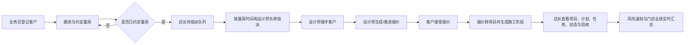

# 装得清小程序 · 店长视角业务闭环与强视图交互

> 适用端：`th4-decoboon-app` 微信小程序 / H5  
> 服务端：`th4-decoboon` Provider API  
> 角色：`StoreManager`，数据范围固定为“当前企业 + 当前门店”

## 1. 店长职责边界

店长不是单个业务员的放大版，也不是老板的缩小版。店长负责把门店客户、设计师产能、报价推进、项目履约、现场风险、通知和业绩串成一张可执行的门店经营视图：

1. 查看本门店全部客户，不查看其他门店客户。
2. 将业务员约定量房后的客户指派给本门店设计师，并结合设计师负荷处理。
3. 查看门店全部报价，推动草稿提交和待确认报价转化。
4. 查看门店全部项目、工地阶段、施工计划、任务节点、动态和验收状态。
5. 查看门店团队，邀请本门店设计师、项目经理和家装顾问。
6. 接收待指派、报价停滞、项目停工和施工逾期通知。
7. 查看门店签约额、报价接受率、设计师经营排名、项目结构和履约风险。

服务端权限边界：

- 客户、报价、项目均以登录店长的 `company + store` 重新计算范围，不接受前端传入 `companyId/storeId`。
- 项目详情、阶段、任务、动态、验收和成员接口统一通过 `ProjectAccessContext` 校验门店归属。
- 指派设计师必须同时满足：客户属于当前门店、设计师属于当前企业、设计师属于当前门店、客户已约定量房。
- 店长邀请成员时，邀请继承当前企业和当前门店，不能邀请其他店长或负责人。
- 响应字段仍按 Provider 的 `@Properties` 白名单输出，不返回前端页面不需要的完整聚合。

## 2. 门店强视图页面地图

| 维度 | 页面 | 店长看到的事实 | 主要动作 |
| --- | --- | --- | --- |
| 工作台 | `pages/index/index` | 门店客户、待指派、待推进报价、施工风险、门店签约额 | 进入调度、客户、报价、项目、团队、业绩、通知 |
| 客户 | `pages/customer/list` | 本门店全量客户，可单独筛出“待指派设计” | 查看客户、进入详情、登记客户（有权限时） |
| 客户详情 | `pages/customer/detail` | 负责人、接手设计师、跟进记录、量房、报价、项目 | 指派/更换设计师、跟进、量房、查看报价与项目 |
| 设计调度 | `pages/manager/designers` | 待指派客户、设计师人数、在施项目、逾期任务、设计师负荷 | 一键指派设计师、进入客户详情、进入报价/项目/团队 |
| 报价池 | `pages/quote/list` | 本门店全部报价及金额、状态、负责人 | 按状态筛选、查看报价详情、推进报价 |
| 报价详情 | `pages/quote/detail` | 套餐、报价明细、成本、折扣、客户确认状态 | 提交、确认接受、驳回、转项目（按状态和权限） |
| 项目 | `pages/project/list` | 本门店全部项目、状态、设计/项目经理、进度 | 查看项目工地、按状态筛选 |
| 工地详情 | `pages/project/detail` | 阶段进度、任务、动态、成员、验收、合同金额 | 查看计划、任务、日报、相册、成员和验收 |
| 施工计划 | `pages/project/plan`、`pages/project/plan-edit` | 阶段甘特、任务工作量、计划偏差 | 查看计划；编辑能力仍受服务端编辑角色校验 |
| 现场动态 | `pages/dynamic/index` | 本门店项目现场汇报和日报时间线 | 查看现场证据、定位异常项目 |
| 验收 | `pages/accept/edit` | 阶段验收、客户确认和整改结论 | 查看验收闭环（确认动作受角色权限控制） |
| 门店团队 | `pages/team/list` | 当前门店成员，不返回其他门店成员 | 按岗位筛选成员 |
| 邀请成员 | `pages/team/invite` | 店长可邀请本门店设计师、项目经理、顾问 | 生成邀请令牌、复制邀请、微信分享 |
| 消息通知 | `pages/msg/list` | 待指派、报价、项目、任务和系统通知 | 筛选、已读、跳转关联业务对象 |
| 业绩 | `pages/performance/index` | 门店签约额、报价接受率、项目结构、设计师排名、履约风险 | 查看设计师排名、最近项目、进入报价池 |
| 我的 | `pages/mine/index` | 当前门店、团队成员、门店项目、设计调度和门店业绩入口 | 查看身份、进入管理功能、退出登录 |

## 3. 店长业务闭环



### 3.1 客户到指派

- 业务员完成首次跟进和量房约定后，客户进入 `PendingMeasure`。
- 消息中心为门店店长生成“客户待指派设计师”提醒。
- 设计调度页按量房时间排序展示客户，并同时展示每位设计师的客户数、待报价、在施项目和逾期任务。
- 店长提交 `customer/customer/handoff` 后，服务端重新校验客户门店、设计师门店和量房时间。
- 成功后客户写入 `designer` 与 `handedOffAt`，同时通知设计师和客户负责人。
- 指派完成后客户从待指派队列移除，进入设计师经营视图。

### 3.2 报价到项目

- 报价金额由服务端根据套餐、面积和折扣计算，店长不可直接修改金额。
- 店长可看到门店全部报价，包括草稿、待客户确认、已接受、已驳回和已转项目。
- 门店工作台汇总待推进报价数量，提醒草稿提交和客户确认。
- 已接受报价转项目后，项目通过客户门店归属进入店长项目范围。

### 3.3 项目履约与风险

- 项目列表、详情、阶段、任务、动态、成员和验收均按项目客户门店校验。
- 店长可查看阶段进度、计划日期、施工任务、现场动态、验收状态和合同金额。
- 门店报表汇总待开工、施工中、待验收、停工、完工项目，以及待办和逾期任务。
- 停工项目和逾期任务会形成店长通知，优先进入工作台“需要关注”。

### 3.4 团队与通知

- 老板邀请店长时，邀请继承企业及邀请时门店。
- 店长邀请成员时，只能生成本门店、本企业邀请，不能邀请负责人或其他店长。
- 通知只按当前登录员工读取，不能通过前端 `receiverRole` 越权读取他人通知。
- 店长通知中心只聚合门店待指派、待推进报价、停工项目和逾期任务。

### 3.5 门店业绩

门店报告按当前门店实时聚合，不新增可人工篡改的统计表：

- 签约额 = 门店项目合同金额汇总。
- 报价接受率 = 已接受/已转项目报价数 ÷ 门店报价总数。
- 设计师排名按逾期任务降序、签约额降序排列。
- 每位设计师展示负责客户、待量房、报价、接受率、项目、在施项目、逾期任务和现场动态数量。

## 4. Provider 对照

| 能力 | Provider | 店长范围 |
| --- | --- | --- |
| 当前员工 | `user/info` | 当前登录员工 |
| 门店成员 | `user/employee/page` | 当前企业 + 当前门店 |
| 设计师列表 | `user/designer/list` | 当前企业 + 当前门店 |
| 邀请成员 | `user/invite` | 负责人可邀请店长；店长可邀请本门店成员 |
| 客户分页/详情 | `customer/customer/page|info` | `@DataPermission(Store)` |
| 客户指派 | `customer/customer/handoff` | 当前门店客户 + 当前门店设计师 |
| 报价分页/详情 | `trade/quote/page|info` | 当前门店客户报价 |
| 项目分页/详情 | `project/project/page|info` | 当前门店客户项目 |
| 阶段/任务/动态/验收/成员 | `project/*` | `ProjectAccessContext` 校验当前门店 |
| 通知 | `collab/notice/page|count|update` | 当前店长本人 |
| 门店经营报告 | `statistic/store/report` | 当前企业 + 当前门店 |

## 5. 强交互规则

- 首页只突出可执行事项：待指派、待推进报价、停工/逾期风险，不堆叠无动作的数据。
- 设计调度页的指派使用动作面板展示设计师负荷，指派过程展示 loading，成功后重新拉取服务端数据。
- 客户列表提供“待指派设计”一级筛选，客户详情仍保留最终指派入口，避免只能在单一页面操作。
- 团队、项目和报价页对空态、无权限、加载失败分别给出明确文案。
- 所有状态推进以服务端返回为准；前端不做本地状态机猜测。
- 成功后重新请求列表/详情；越权或失效由服务端返回 403/404，前端不展示不存在的数据。

## 6. 开发联调账号

企业负责人：

```text
手机号：18660219918
密码：123456
```

店长开发账号：

```text
手机号：18660219920
密码：123456
门店：总店
```

当前门店已有设计师 `18660219919`，待指派客户会进入设计调度页；店长完成指派后，客户详情、消息通知和门店业绩会同步刷新。

## 7. 验收顺序

1. 使用企业负责人登录，进入团队邀请页，选择“店长”并生成邀请。
2. 接受邀请并设置密码，使用店长账号登录。
3. 检查工作台四项指标：门店客户、待指派、待推进报价、施工风险。
4. 进入设计调度，选择待指派客户并指派本门店设计师。
5. 返回客户详情，确认接手设计师和指定时间已更新。
6. 分别进入报价、项目、计划、动态、验收、消息和门店业绩，确认只出现本门店数据。
7. 使用其他门店或非本企业账号访问同一数据，预期返回 404/403，且不泄露实体归属。
